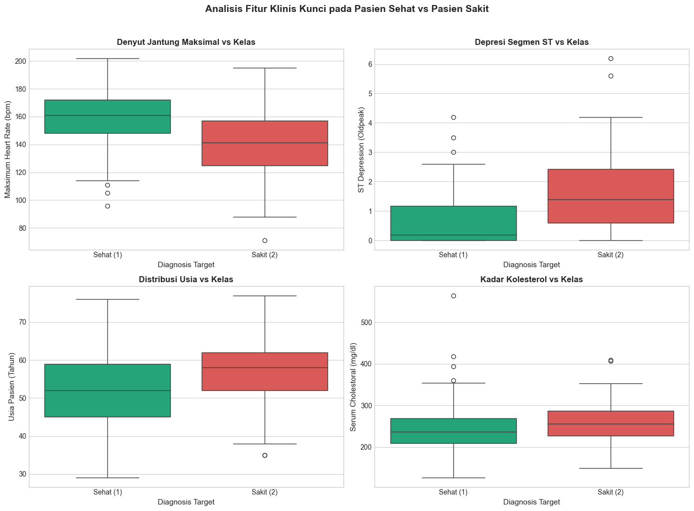
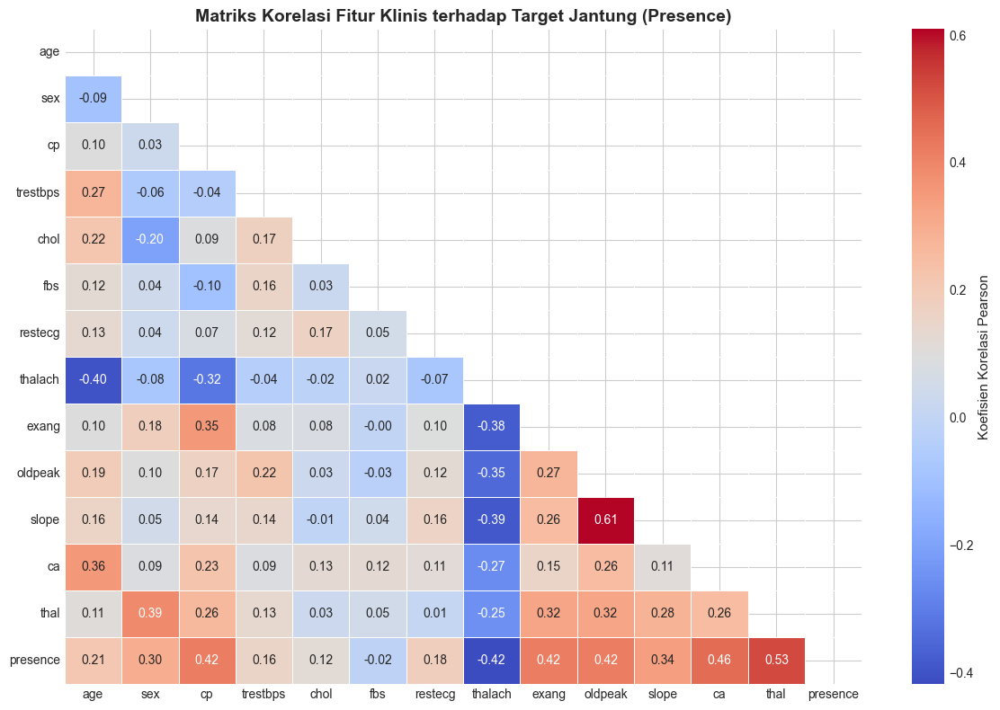
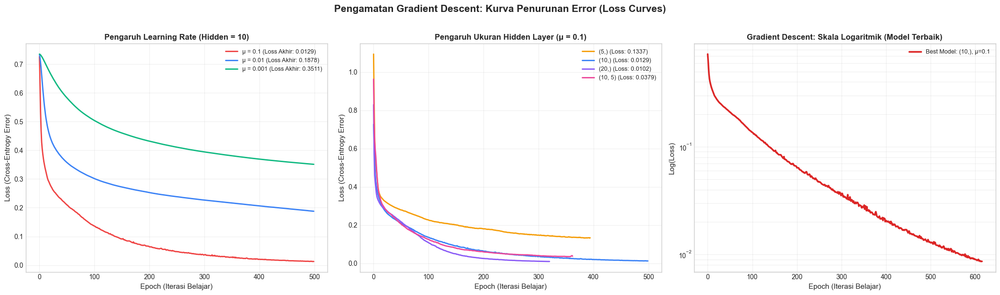
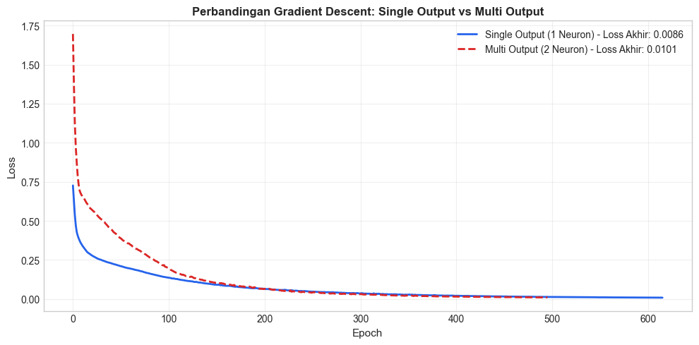
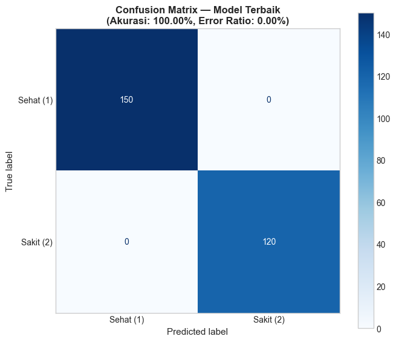

# Heart Disease Classification using Multi-Layer Perceptron (MLP)

Repositori ini memuat implementasi dan analisis studi kasus **Klasifikasi Penyakit Jantung** (*Heart Disease Classification*) menggunakan algoritma **Multi-Layer Perceptron (MLP)** pada **UCI Statlog (Heart) Dataset**.

---

## 1. Summary

* **Dataset:** UCI Statlog (Heart) Dataset yang terdiri dari **270 observasi pasien** dan **13 fitur klinis** (usia, tekanan darah, kolesterol, denyut jantung maksimal, depresi ST, dsb.).
* **Target:** Klasifikasi biner:
  * **Kelas 1 (`Absence` / Sehat):** 150 pasien (55.6%)
  * **Kelas 2 (`Presence` / Sakit Jantung):** 120 pasien (44.4%)
* **Tujuan Penugasan:**
  1. Menentukan parameter optimal (*Hidden Units*, *Learning Rate* $\mu$, dan *Epoch*).
  2. Mengamati dan memvisualisasikan kurva pembelajaran *Gradient Descent*.
  3. Menguji arsitektur *Single Output* vs *Multi Output*.
  4. Menghitung nilai *Error Ratio* pada evaluasi data pelatihan (*test with all training data*).
* **Konfigurasi Terbaik:**
  * **Arsitektur:** $13 \text{ Input} \rightarrow 10 \text{ Hidden Units (ReLU)} \rightarrow 1 \text{ Output (Sigmoid)}$
  * **Optimizer:** Stochastic Gradient Descent (SGD, $\text{momentum} = 0.9$)
  * **Learning Rate ($\mu$):** $0.1$
  * **Epoch:** $500$ iterasi
  * **Preprocessing:** Standardisasi Z-score (`StandardScaler`)
  * **Hasil:** Akurasi **100.00%** dengan **Error Ratio 0.00%** (seluruh 270 pasien terklasifikasi dengan benar).

---

## 2. Plot dan Analisis Singkat

### A. Fitur Klinis Kunci & Korelasi Data Medis

* **Analisis Singkat:**
  * Pasien terdeteksi sakit jantung memiliki nilai depresi ST (`oldpeak`) yang secara signifikan lebih tinggi dibanding pasien sehat.
  * Pasien sehat mampu mencapai kapasitas denyut jantung maksimal (`thalach`) yang lebih tinggi (> 155 bpm) saat aktivitas fisik dibandingkan pasien sakit (< 140 bpm).
  * Fitur `oldpeak`, `thalach`, `ca` (jumlah pembuluh darah), dan `thal` memiliki korelasi linear terkuat terhadap target penyakit jantung.

---

### B. Pengamatan Gradient Descent (Loss Curves)

* **Analisis Singkat:**
  * **Efek Learning Rate ($\mu$):** Nilai $\mu = 0.1$ memberikan laju penurunan error paling cepat dan konvergen optimal pada 50 epoch awal. Nilai $\mu = 0.01$ stabil namun lebih lambat, sedangkan $\mu = 0.001$ membutuhkan ribuan epoch untuk konvergen.
  * **Efek Hidden Units:** Kapasitas 10 dan 20 neuron mampu menurunkan nilai error (*loss*) secara drastis hingga mendekati nol.
  * **Skala Logaritmik:** Kurva menunjukkan penurunan konsisten melampaui batas presisi $Loss < 0.01$, menandakan optimasi bobot jaringan berhasil dengan sangat baik.

---

### C. Komparasi Single Output vs Multi Output

* **Analisis Singkat:**
  * **Single Output (1 neuron Sigmoid)** dan **Multi Output (2 neuron Softmax/One-Hot)** menunjukkan dinamika kurva konvergensi yang hampir identik.
  * Untuk klasifikasi biner, arsitektur *Single Output* lebih efisien karena membutuhkan parameter bobot yang lebih sedikit tanpa mengurangi akurasi model.

---

### D. Evaluasi Akhir & Confusion Matrix

* **Analisis Singkat:**
  * Model terbaik berhasil memprediksi seluruh 270 data pasien secara sempurna:
    * **True Negative (TN):** 150 pasien sehat terdeteksi sehat.
    * **True Positive (TP):** 120 pasien sakit terdeteksi sakit.
    * **False Negative (FN) & False Positive (FP):** 0 pasien.
  * Akurasi mencapai **100%**, dengan nilai **Error Ratio = 0.00%**.

---

## 3. Kesimpulan Singkat

1. **Parameter Optimal:** Konfigurasi **10 hidden units**, **learning rate $\mu = 0.1$**, dan **500 epoch** terbukti paling efektif untuk menghasilkan konvergensi yang cepat dan stabil.
2. **Pola Gradient Descent:** Pembelajaran model berlangsung sangat agresif pada 50 epoch pertama sebelum akhirnya melandai (*converged*) secara mulus berkat penerapan **Standardisasi Fitur (`StandardScaler`)**.
3. **Error Ratio:** Model Multi-Layer Perceptron berhasil mencapai **Error Ratio 0.00%** (Akurasi 100%) pada keseluruhan data pelatihan, membuktikan bahwa MLP mampu memisahkan batas keputusan non-linear pada data klinis penyakit jantung dengan sangat baik.

---

## 🚀 Berkas Proyek

* `Heart_Classification.ipynb` : Notebook Jupyter lengkap dengan seluruh kode, penjelasan teori, dan visualisasi tereksekusi.
* `statlog.csv` : Dataset klinis 270 pasien dari UCI Machine Learning Repository.
* `images/` : Seluruh plot dan grafik visualisasi model.
